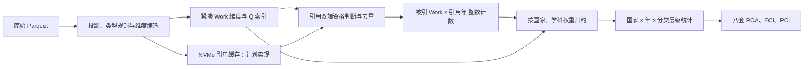

> 状态更新（2026-11-12）：本文保留最初工程方案与基线描述；当前实施与验收状态见 [goal-progress.md](goal-progress.md) 和 [README](../README.md)。统一统计契约以 [goal-prompt.txt](goal-prompt.txt) 为准。全量已计算，独立验收进行中；下文“未实现/未确认/未启动”等描述属于初始阶段，不代表当前状态。

# OpenAlex 国家年度学科统计：工程技术方案

日期：2026-11-12。开发语言以Go为默认，已用三个subagent并行开发首批模块。本文同时区分已验证基线和全量运行前仍需完成的优化，不把方案项写成已上线能力。

## 1. 统计契约

- 统计输出年份从2000起；2026截至快照6月26日，标记不完整年。
- 文献类型按已接受的15类黑名单处理，其余默认保留，包括other与未知类型；不把风险标记变成隐藏白名单。
- 四套分类层级独立：Topics Field 26、Subfield 252；Concepts Level 0 19、Level 1 284。
- 先确定统一文献集合Q；仅计算施引和被引两端都在Q的引用边。以施引发表年确定引用年，以被引文献归属确定国家和学科。
- 每对(source,target)只计一次。作者自引未排除；同Work自环单列质量统计，当前基线保留，正式样本应审定是否去除。
- 产出和限定范围内被引分别生成四层年度矩阵，共8套ECI/PCI。
- 2000年前被引对象、XPAC、国家权重和Concepts阈值仍是显式参数。工程结构支持切换，但不会把试跑参数冒充已确认口径。
- ECI矩阵排除UNKNOWN国家/学科，UNKNOWN保留在基础统计和质量报告。RCA的世界分母为该模型有效矩阵元素之和，与原始文献总数、全计数下的唯一论文数不是同一量。

## 2. 229实测资源与数据规模

| 项目 | 实测或带来源的规模 |
|---|---|
| CPU | 2×Xeon E5-2678 v3，共24物理核、48逻辑线程，2个NUMA节点 |
| RAM | 755GiB；探测时MemAvailable约729GiB |
| 源数据盘 | /mnt/hg02，机械盘，约5.3TiB可用 |
| NVMe可用 | nvme0约984GiB、nvme1约1015GiB、nvme2约955GiB，容量会随其他任务变化 |
| 工具 | Go 1.26.0，DuckDB CLI 1.4.1 |
| 快照 | 2026-06-26，Works 510,372,821条、2,446文件、约725GB压缩体积 |
| 引用列 | 已有同manifest哈希的2026-09-23元数据盘点：3,473,805,571个叶槽，压缩列约31.7GB |

引用叶槽包含空值占位及重复，并非可用引用边数量。已有graph-go/graph-rust工具只作复用候选，其数据结构和统计边界必须重新核验；不继承既有专题研究的过滤结果。

来源：[本次硬件探测](../research/server-229-capacity.txt)、[已有引用列盘点](../research/existing-reference-inventory.json)、[全量类型审计](../research/snapshot-type-audit.md)。服务器当前已有其他服务与任务，不停止或清理它们。

## 3. Go默认技术栈

| 环节 | 默认实现 | 选择理由与边界 |
|---|---|---|
| CLI、并发与调度 | Go标准库、context、channel、worker pool | 一个全局CPU预算，批次传递，取消与背压 |
| Parquet | parquet-go/parquet-go v0.32.0 | 投影所需列、支持嵌套；本项目fixture及真实快照均已验证 |
| ID索引、引用、归约 | Go连续数组、整数ID、分片任务 | 热路径不依赖字符串Work对象和每边消息 |
| ECI/PCI | Gonum v0.17.0 | Go内矩阵与对称特征分解，矩阵规模很小 |
| 独立对照 | 现有DuckDB CLI | 验证筛选、边数量和分组结果，不作为尚未证实更快的默认生产引擎 |
| 交付 | Parquet＋JSON；未来查询层可用Go | 不为几百万聚合行引入大型数据库服务 |

固定依赖版本并保留go.sum；不升级全局Go或DuckDB。当前应用可CGO=0构建，229支持GOAMD64=v3。[parquet-go](https://github.com/parquet-go/parquet-go)、[Gonum](https://pkg.go.dev/gonum.org/v1/gonum/mat)

只有在同投影列、同统计语义的代表性冷/热缓存基准中，替代引擎正确且稳定快至少25%，才采用Go调用的DuckDB/Arrow等适配器；阈值是本项目工程决策标准，不是已有性能结论。若采用原生引擎，Go线程、原生线程和原生内存纳入同一全局预算，禁止多层并发相乘。[DuckDB Go客户端](https://duckdb.org/docs/current/clients/go/overview)

## 4. 数据流与避免重复计算

**关键优化：每条引用先只增加target×year计数；最后才展开国家与学科。**避免数十亿条边逐条乘以国家数、Concepts标签数及四个统计层级。

阶段设计：

1. 检查manifest、schema、实际类型值域和输入文件指纹，记录规则及源码版本。
2. 从机械盘顺序读取必要列，生成稳定整数ID与紧凑维度。生产优化版同时把投影结果及引用列表写入NVMe分片，后续口径重跑不再反复解码原始嵌套列。
3. 构建Q精确索引。默认基线为map[uint64]uint32，随后与固定容量分片哈希比较吞吐和RSS，禁止只因自定义结构“看起来快”就替换。
4. 流式读取引用列表，校验施引资格和年份，去重单篇参考列表，目标命中Q后累加计数。基线为原子累加；生产优化对比分片所有者归约和原子方案。
5. 按target ordinal连续遍历维度和年份计数，分worker聚合、固定顺序合并；国家全计数/均分和Concepts标签权重分别配置。
6. 固定分类字典，分年/层级/指标构造矩阵，求ECI/PCI，输出模型有效性及活跃标签索引。
7. 输出数据、质量报告、配置与完成标记；校验通过的run才发布到本地latest指针。

当前版本已实现双pass的第1、2（内存维度）、3、4、5、6及基础导出；NVMe投影缓存与分片检查点仍待开发。不存在默认启动的全量任务。

## 5. 内存结构与预算

- Work ID转uint64，dense ordinal用uint32；超过容量直接拒绝，不能截断。
- 国家、Field、Subfield和Concept ID使用小字典；多国家、多Concept采用CSR偏移＋连续整数数组，分数单独列存。
- 不持有数亿个带string/slice字段的Work对象；scanner回调借用数据，在跨goroutine传递引用列表时明确复制或转移所有权。
- 当前uint64年度引用计数最坏上限：510,372,821×27×8，约102.7GiB。索引基线估计约19GiB，维度按实测容量另算。
- 若重新验证引用槽上界足以证明所有计数小于2^32，可压测uint32计数＋uint64总和，降低内存带宽；默认基线保持uint64，尚未采用压缩位宽。
- 原始引用数值列表的理论容量约25.9GiB，另加CSR偏移与状态，说明引用列有机会整体常驻RAM；不可据此推断所有原始嵌套数据也应装入内存。

全量应用规划预算上限**640GiB**，Go软限制为其85%，约544GiB，其余容纳解码峰值、非Go/映射区域等。保留至少64GiB主机MemAvailable并监测其他任务用量；GOMEMLIMIT不是RSS硬限制，也不覆盖所有原生/映射内存。[Go GC与内存限制](https://go.dev/doc/gc-guide)

RAM用于索引、计数阵列、引用缓存及有复用价值的页缓存。若有效工作集只需200GiB，就不会额外占用500GiB来制造90%内存利用率。超过90%的有用RAM覆盖是容量优化目标，不能代替吞吐和正确性验收。

## 6. CPU、磁盘与90%目标

- 计算阶段以整机48逻辑CPU为分母，项目进程CPU目标≥90%，观察稳定窗口至少60秒。任务默认从46个Go逻辑CPU预算开始，允许根据其他服务负载和吞吐下调。
- 分别测试8/16/24/32/40/46 workers，以及1/2/4/8/16 reader；先找读者最优点再调计算worker，避免盲目全组合压测。
- 单机械盘读取初期受I/O限制，reader从1—4开始；数据进入NVMe或RAM后再扩大解码/图处理并发。
- 列表去重、资格查询、计数和归约均以批次调度。当前按文件并发且有序回调，后续行组任务要处理文件倾斜与队头阻塞。
- 两NUMA节点上的大数组先比较普通分配、内存交错和分片就近分配；以实际边吞吐决定，不能只按逻辑核数翻倍。
- 首次HDD投影、短ECI任务和最终落盘阶段不承诺CPU/RAM同时90%。如CPU低，必须用pprof、队列长度、吞吐、I/O延迟和内存带宽定位瓶颈，并给出调优记录。
- 核心验收指标是正确records/s、edges/s及全阶段总耗时。iowait、GC空转、重复计算不算有效高利用率。

NVMe规划配额：nvme0投影650GiB、nvme1引用/图分片512GiB、nvme2临时归并512GiB；每盘至少保留128GiB。配额是方案预算，目录尚未创建，实际运行前重新检查容量。原始快照只读，应用不更改系统swap或停止其他服务。

## 7. 并发开发拆解

| 任务 | 已分配与首批交付 | 后续工作 |
|---|---|---|
| subagent：scan | 嵌套Parquet投影、空值保真、并发文件读取、稳定行数限制与fixture | 行组调度、NVMe投影器、读放大与吞吐基准 |
| subagent：graph | 精确Q索引、并发引用计数、单篇去重、预算与取消、手算图测试 | 索引/计数布局基准、分片归约、可恢复检查点 |
| subagent：metrics | 四层加权统计、worker合并、RCA/ECI/PCI与退化检测 | 稳定字典导出、敏感性对照与性能复核 |
| 主agent：integration | CLI、黑名单、紧凑维度、两pass完整性摘要、资源采样、端到端测试 | 资源控制器、全量编排、manifest/hash完成协议 |

模块通过internal/model契约衔接；每个agent只写分配目录，主agent统一依赖、配置和集成。开发并发与运行时并发是两个独立层面。

## 8. ECI数值实现

对每年每层矩阵X，计算RCA及M=1[RCA>=1]。国家/学科度分别为kc、kd。

使用对称相似矩阵S=Dc^(-1/2) M Dd^(-1) M^T Dc^(-1/2)求次特征向量，再转换到国家算子的右特征向量并标准化。不能把非对称国家算子直接当对称矩阵送入EigenSym。

ECI和PCI与ActiveCountries/ActiveDisciplines索引对齐。零行列不赋伪零分；优势网络断连或特征值退化时给出状态，不强行排名。首个有效年按多样性相关性定向，后续按共同国家对齐符号，并同步翻转PCI；方向不稳定及特征间隙应进一步记录。

跨年固定分类层级和字典，年度零列仍在标签空间但不进入有效矩阵。每年标准化分数表达相对位置，不能解释为绝对知识量增长。

## 9. 可恢复与可复现：生产阶段的必要工作

run_id绑定manifest SHA256、统计配置、输入选择、源码和依赖版本。投影与引用分片记录输入文件/行组范围、行数、资格与边计数、内容哈希、完成状态。

分片写临时文件，flush/fsync后原子提交完成标记；恢复只读取已校验分片。归约以分片ID去重，禁止重启后再把同一分片计入已有总表。Q变更必须重算受影响的引用图，不能复用旧Q的target-year计数冒充新结果。

当前基线通过两pass行数、基准字段/资格摘要及文件size/mtime检测意外输入变化，输出目录不可覆盖；尚无分片恢复能力。该保护不能替代全量文件内容校验或事务化检查点。

## 10. 已完成验证与下一阶段验收

已通过本地go test、go vet，以及229上的Go race测试；有手算引用图、黑名单JSON往返、2000年前目标两种策略、分摊守恒、特征向量残差、断连/退化和Parquet真实嵌套fixture。

229真实文件前100,000行试跑（显式all语料、保留旧目标、国家/Concepts均分、阈值0，仅开发参数）：

| 指标 | 实测 |
|---|---:|
| 黑名单后文献 | 48,319 |
| 集合内去重引用 | 581 |
| 其中同Work自环 | 388（当前基线保留并单列） |
| cube行数 | 127,843 |
| 年×层级×输入模型 | 216（含empty/disconnected等有效性状态，不等于216套有效分数） |
| 总耗时 | 约7.03秒 |
| 平均整机CPU占比 | 约2.47% |
| 采样峰值RSS | 约490MiB |

48319/581/388与独立DuckDB SQL完全一致。样本仅形成局部诱导子图，绝大多数目标不在样本内，不能当作全球引用覆盖或ECI结论。单文件试跑也不能用于宣称全量速度、90%利用率或总工期。

下一阶段依次验收：

1. 多文件/行组代表性样本，记录冷/热缓存、worker/readers、CPU/RSS、读取字节与records/s，确定Go扫描瓶颈；比较有证据的替代引擎。
2. 实现NVMe投影缓存、引用分片及故障恢复；通过重复启动不重复计数、取消后恢复、输入变化拒绝复用等测试。
3. 在百万/千万级样本做索引、原子/分片计数、NUMA布局对比，优化计算阶段有效CPU至90%目标；RAM工作集按预算增长。
4. 用独立SQL检查年度/国家/学科分组，验证分摊守恒、未知值覆盖与各规则流失量；固定统计未定项。
5. 基于代表性实测给出全量耗时和临时空间估算，再运行完整快照，生成逐年质量报告及八套模型。

实际代码运行结果见[试跑报告](../research/pilot-100k-report.json)和[SQL对照](../research/pilot-oracle.sql)。正式全量运行及90%利用率目标均尚未验证，不将该基线标记为生产性能验收完成。

